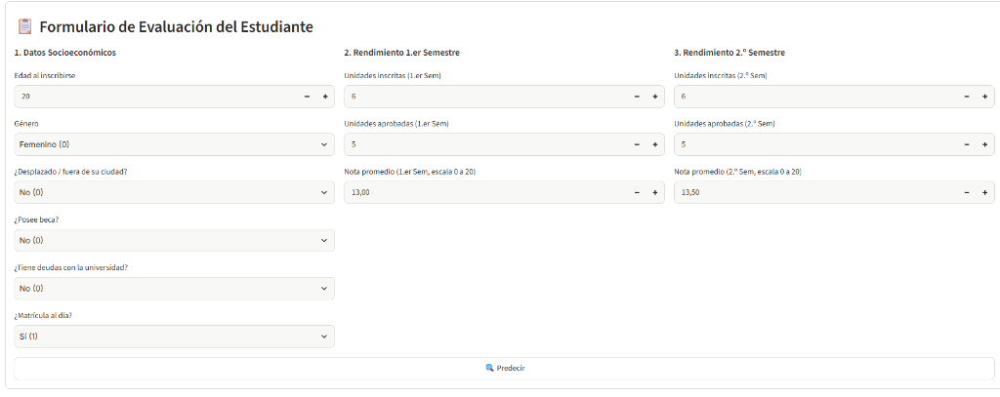
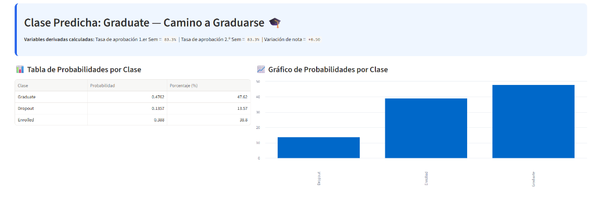

# Sistema de Predicción Temprana de Deserción y Éxito Académico (Spark ML)

**Autor:** Andrés Felipe Maestre Badillo  
**ID:** U00071243  

## Descripción
Aplicación web interactiva desarrollada en **Streamlit** que despliega un `PipelineModel` (`RandomForestClassifier`) entrenado en **Apache Spark ML** para clasificar estudiantes universitarios en tres categorías: `Graduate`, `Dropout` y `Enrolled`.

El flujo completo incluye:
- Preprocesamiento y limpieza de datos en PySpark ([Parcial_BIGDATA.ipynb](https://github.com/afmae556/parcial-sparkml-streamlit/blob/main/Parcial_BIGDATA.ipynb)).
- Ingeniería de características (tasas de aprobación del 1.er y 2.º semestre y variación de notas).
- Pipeline completo (`StringIndexer`, `OneHotEncoder`, `VectorAssembler`, `StandardScaler` y clasificación multiclase con ajuste de hiperparámetros por validación cruzada).
- Despliegue del modelo entrenado ([modelo_final/](https://github.com/afmae556/parcial-sparkml-streamlit/tree/main/modelo_final) / [modelo_final.zip](https://github.com/afmae556/parcial-sparkml-streamlit/blob/main/modelo_final.zip)) en una interfaz web con Streamlit ([app.py](https://github.com/afmae556/parcial-sparkml-streamlit/blob/main/app.py)).

## Enlaces de Entrega
- **Aplicación Pública en Streamlit Community Cloud:** https://parcial-sparkml-app-sjimnhcnsezdsqwri9qwy4.streamlit.app/
- **Repositorio de GitHub:** https://github.com/afmae556/parcial-sparkml-streamlit
- **Notebook Ejecutado (.ipynb en GitHub):** https://github.com/afmae556/parcial-sparkml-streamlit/blob/main/Parcial_BIGDATA.ipynb
- **Abrir Notebook en Google Colab:** https://colab.research.google.com/github/afmae556/parcial-sparkml-streamlit/blob/main/Parcial_BIGDATA.ipynb
- **Modelo Final (Carpeta Spark ML):** https://github.com/afmae556/parcial-sparkml-streamlit/tree/main/modelo_final
- **Modelo Final (.zip):** https://github.com/afmae556/parcial-sparkml-streamlit/blob/main/modelo_final.zip
- **Código de la App (`app.py`):** https://github.com/afmae556/parcial-sparkml-streamlit/blob/main/app.py
- **Dependencias (`requirements.txt`):** https://github.com/afmae556/parcial-sparkml-streamlit/blob/main/requirements.txt
- **Dependencias del sistema (`packages.txt`):** https://github.com/afmae556/parcial-sparkml-streamlit/blob/main/packages.txt

## Cómo ejecutarla localmente
1. Asegurarse de contar con Java (`default-jre`) y Python 3.10+.
2. Instalar las dependencias:
   ```bash
   pip install -r requirements.txt
   ```
3. Iniciar la aplicación:
   ```bash
   streamlit run app.py
   ```

## Evidencias de la Aplicación Desplegada

### 1. Formulario de Evaluación del Estudiante


### 2. Resultado de la Predicción y Probabilidades por Clase

